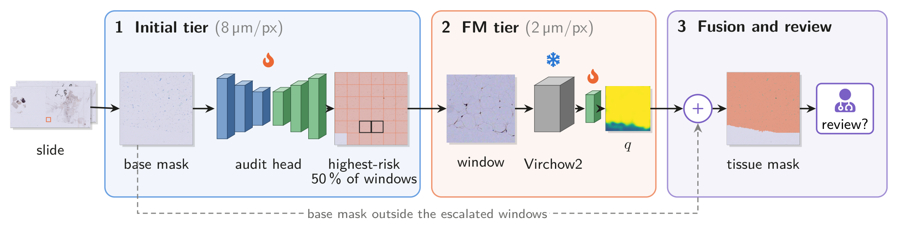
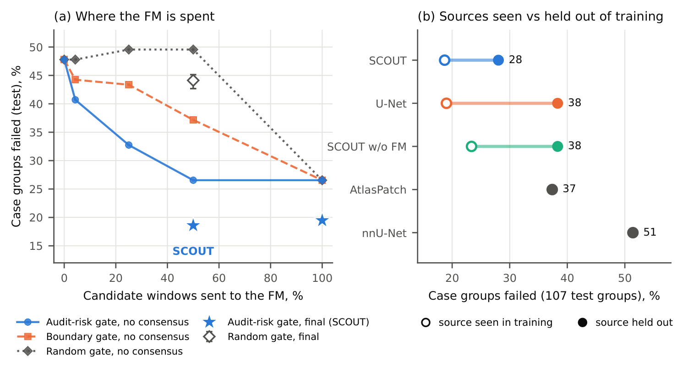
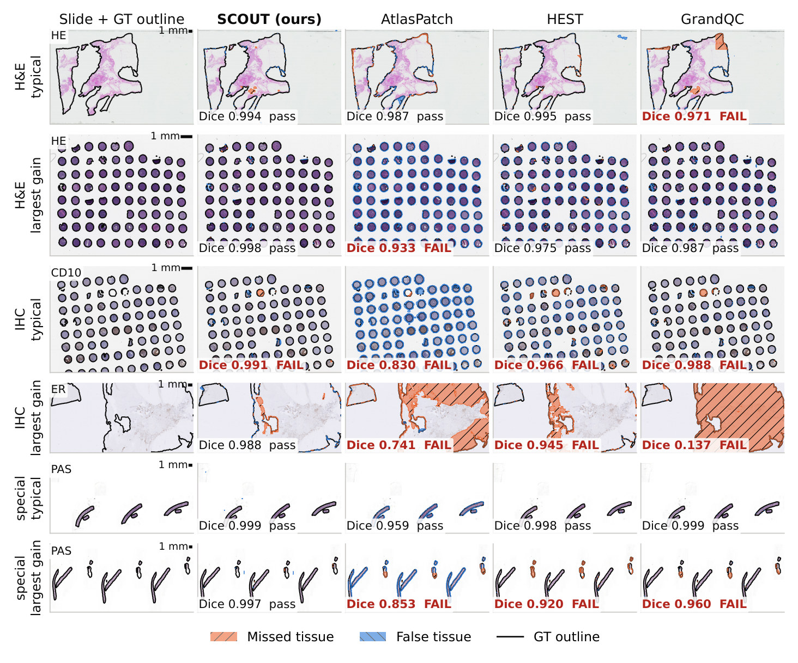

<div align="center">

# SCOUT

**Robust tissue detection for whole-slide images, with a foundation model spent only where it matters**

[](https://pypi.org/project/scout-tissue/)
[](https://pypi.org/project/scout-tissue/)
[](https://github.com/CosmoIknosLab/scout-tissue-detection/blob/main/LICENSE)
[](https://huggingface.co/Cristiandieti/scout-tissue-detection)
[](https://doi.org/10.5281/zenodo.23664072)

[Project page](https://cosmoiknoslab.github.io/scout-tissue-detection/) · [Install](#install) · [Quick start](#quick-start) · [Results](#results) · [Citation](#citation)



</div>

Tissue detection is the first step of almost every computational pathology pipeline, and its errors pass silently into everything downstream: a missed needle-biopsy fragment or a pale immunohistochemistry section is simply never analysed. **SCOUT** (Selective Correction Of Uncertain Tissue) corrects these errors without running a foundation model on the whole slide:

1. **Initial tier.** A fast optical-density detector gives a mask of the whole slide at 8 µm/px.
2. **Audit.** A small U-Net (1.4 M parameters) predicts, pixel by pixel, where that mask is likely to miss tissue or include background.
3. **Foundation-model tier.** Only the highest-risk half of the candidate windows is re-read at 2 µm/px and re-segmented by a frozen pathology foundation model with a light decoder.
4. **Consensus fusion.** The foundation model can keep tissue that the initial mask found, but adds new tissue only when it is confident, so glass and debris do not become tissue.

This package, `scout-tissue`, runs **SCOUT-open**, the variant built on the Apache-licensed [H-optimus-0](https://huggingface.co/bioptimus/H-optimus-0) foundation model. It returns a binary tissue mask placed exactly on the slide's level-0 pixel frame, as NumPy, PNG or GeoJSON (QuPath-ready).

## Install

```bash
pip install scout-tissue
pip install "scout-tissue[demo]"     # with the browser demo
```

Python ≥ 3.10. OpenSlide comes with the `openslide-bin` wheel, so no system library is needed. Install PyTorch first if you need a specific CUDA build ([pytorch.org](https://pytorch.org)).

> **H-optimus-0 is gated.** Accept its terms at <https://huggingface.co/bioptimus/H-optimus-0> and log in (`huggingface-cli login` or `HF_TOKEN`). The SCOUT heads (~7 MB) and H-optimus-0 (~4.5 GB) are downloaded on first use into your Hugging Face cache; afterwards `--offline` (or `HF_HUB_OFFLINE=1`) works without network.

## Quick start

**Command line**

```bash
scout-tissue predict slide1.svs slide2.ndpi --out masks/ --format npz,png,geojson
```

The models are loaded once for all slides. Useful options: `--device cuda|cpu`, `--skip-existing`, `--timing`, `--readers N`, `--audit-ckpt` / `--fm-head` (local weights), `--cache-dir`, `--offline`. `scout-tissue download` fetches the weights in advance.

**Python**

```python
from scout_tissue import Scout

scout = Scout.from_pretrained(device="cuda")   # loads the models once
res = scout.predict("slide.svs")

res.mask              # bool array [H, W] on the 8 µm/px grid
res.mpp, res.grid     # 8.0, Grid(origin_x, origin_y, scale, height, width, mpp)
res.tissue_area_mm2   # tissue area
res.to_geojson()      # tissue polygons in level-0 pixel coordinates
res.save("masks/", ("npz", "png", "geojson"))
```

Saved masks are read back with `scout_tissue.load_npz(path)` → `(mask, grid)`.

**Browser demo**

```bash
scout-tissue demo --port 7860
```

Pick a slide on the server or upload one; the demo shows the thumbnail, the mask, the windows sent to the foundation model and the audit risk map, with npz and GeoJSON downloads.

## Results

Evaluated on the public multi-source, multi-stain [Tissues with Issues](https://doi.org/10.5281/zenodo.21649203) benchmark (113 test case groups, 153 slides). A case group *fails* when the mask of one of its slides would need manual correction: more than 2 % of the tissue missed, a fragment of at least 0.1 mm² less than half detected, false tissue above 10 % of the tissue area, or precision below 0.9. Released detectors are evaluated after their post-processing is re-tuned on the development set.

| Method | Test case groups failed | IHC case groups failed |
|---|---:|---:|
| **SCOUT** (paper, Virchow2) | **18.6 %** | **22.0 %** |
| **SCOUT-open** (this package, H-optimus-0) | 19.5 % | – |
| AtlasPatch | 38.1 % | 60.0 % |
| HEST | 47.8 % | 56.0 % |
| nnU-Net (Helgesen et al.) | 50.4 % | 76.0 % |
| GrandQC | 53.1 % | 100.0 % |

On sources held out of training, SCOUT fails on 28.0 % of the case groups, against 38.3 % for a U-Net trained on the same masks and 38.3 % for the same cascade without the foundation model. Sending every candidate window to the foundation model brings no further gain over the riskiest half.



<details>
<summary><b>Qualitative examples</b> (test slides chosen by a prespecified rule)</summary>



</details>

## Output and coordinates

`<slide>.npz`:

| member | content |
|---|---|
| `mask` | bit-packed mask: `np.unpackbits(z["mask"], count=H*W).reshape(H, W)` |
| `shape` | `[H, W]` |
| `mpp` | µm per mask pixel (8.0) |
| `origin_x`, `origin_y` | level-0 pixel coordinates of the mask's top-left corner |
| `scale` | level-0 pixels per mask pixel (`mpp / mpp0`, not rounded) |
| `grid`, `system`, `meta` | the grid as JSON; `"final"`; JSON with counts, thresholds, versions and weight hashes |

Mask pixel (row `r`, column `c`) covers level-0 `x ∈ [origin_x + c·scale, origin_x + (c+1)·scale)` and `y ∈ [origin_y + r·scale, origin_y + (r+1)·scale)`. Level-0 coordinates are OpenSlide's (origin at the top-left corner, x right, y down); the origin is the slide's `openslide.bounds-x/y` (0 if absent, non-zero for many `.mrxs`). The last row and column may extend past the scanned area (treated as glass).

`<slide>.png` is the same mask (255 = tissue, one pixel per mask pixel). `<slide>.geojson` has one `Polygon` per 8-connected tissue component, traced along pixel edges, in level-0 pixel coordinates; features carry a `Tissue` classification, so QuPath imports them as annotations.

The slide's level-0 resolution must be in its metadata: slides without a usable MPP are rejected, never read at a guessed resolution. Only pyramid levels are read; label and macro images are never opened.

## Hardware

A GPU is strongly recommended. Time is dominated by the foundation model on the escalated windows, so it grows with the amount of tissue: on an NVIDIA RTX 5000 Ada with 8 CPU cores, 6–89 s per slide (median ~41 s) on 18 slides from biopsies to large resections, after a one-off model load of ~15 s, with ~6 GB of GPU memory. On CPU only (16 cores) a small biopsy took ~5 min and ~10 GB of RAM.

Masks are deterministic for a given device and software stack; GPU and CPU runs can differ in a few boundary pixels (26 pixels, Dice 0.99997, on one test slide).

## Licences

- **Code:** Apache-2.0 ([LICENSE](https://github.com/CosmoIknosLab/scout-tissue-detection/blob/main/LICENSE)).
- **SCOUT heads:** CC BY-NC 4.0 ([LICENSE-WEIGHTS.md](https://github.com/CosmoIknosLab/scout-tissue-detection/blob/main/LICENSE-WEIGHTS.md)), downloaded from [Hugging Face](https://huggingface.co/Cristiandieti/scout-tissue-detection) and archived on [Zenodo](https://doi.org/10.5281/zenodo.23664072).
- **H-optimus-0** (Bioptimus): Apache-2.0, gated on Hugging Face, not redistributed.
- The paper's main variant uses Virchow2, whose licence restricts models trained on its outputs, so its decoder head is not redistributed; this package runs SCOUT-open.

Research use only; not for clinical decisions.

## Citation

```bibtex
@misc{tommasino2026scout,
  title  = {{SCOUT}: Risk-Guided Foundation-Model Escalation for Robust Tissue Detection in Whole-Slide Images},
  author = {Tommasino, Cristian and Rinaldi, Antonio M.},
  year   = {2026},
  note   = {Preprint, under review}
}
```

Cristian Tommasino and Antonio M. Rinaldi, Department of Electrical Engineering and Information Technology (DIETI), University of Naples Federico II.
